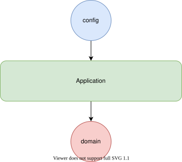
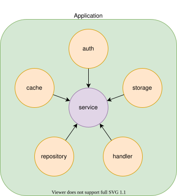

# srcディレクトリ

理解の助けになるかもしれないもの
- https://wiki.trap.jp/user/mazrean/memo/%E8%A8%AD%E8%A8%88%E3%81%A8%E3%83%87%E3%82%A3%E3%83%AC%E3%82%AF%E3%83%88%E3%83%AA%E6%A7%8B%E9%80%A0
- https://slides.mazrean.com/ddd/

## 変更する際のルール

これに従えば、現状の設計を保つことができる実装になっている。

- 常にinterfaceに実装は従う。
  つまり、実装を理由にinterfaceが変わることはない。
- interfaceはpackage間の依存の直接または間接的な依存が変更された場合にのみ変更される。

## 各package(ディレクトリ)の役割

各packageは、直下にinterfaceを置き、サブディレクトリに具体的な実装を置く構成になっている。
例えば、`repository` 直下にinterfaceがあり、`repository/gorm2` にGORMを使った実装がある。
`mock` ディレクトリには、テスト用に [gomock](https://github.com/uber-go/mock) で生成したモックが置かれる(`task` で生成される)。

- domain: アプリケーション全体で共通するルール。エンティティを定義している。
  - values: 値オブジェクト。値は必ずコンストラクタで作る。
- config: アプリケーションの設定。
  - v1: 環境変数から設定を読み取る実装。
- service: アプリケーションのロジック。
  - v2: 現在使われている実装。
  - v1: v1 API時代の実装。現在は `User` / `UserUtils` だけが使われている。
- auth: traQを用いた認証と、traQからのユーザー情報の取得。
  - traQ: traQのAPIを使った実装。
- cache: オンメモリキャッシュ。ユーザー情報と座席の状態をキャッシュしている。
  - ristretto: [ristretto](https://github.com/dgraph-io/ristretto)を使った実装。
- repository: データの永続化。RDBMSの範囲での抽象化になっている。
  - gorm2: [GORM2](https://gorm.io/)でMySQL(MariaDB)を使う実装。
    - schema: DBスキーマを定義する構造体。マイグレーションはここから生成する([docs/migration.md](../docs/migration.md)を参照)。
    - migrate: Atlas導入前のマイグレーションのコード。新しいコードでは使わない。
- handler: HTTPサーバー。
  - `api.go`: [Echo](https://echo.labstack.com/)のサーバーを立て、ミドルウェアとルーティングを設定する。`/api/metrics` でPrometheusのメトリクスを公開している。
  - v2: REST APIの実装。[oapi-codegen](https://github.com/oapi-codegen/oapi-codegen)で [docs/openapi/v2.yaml](../docs/openapi/v2.yaml) から生成したコード(`v2/openapi`)を使っている。権限のチェックは `v2/checker.go` で行う。
  - session: Cookieによるセッション管理。
  - cron: 定期実行ジョブ。現在は1時間ごとに、終了時刻が記録されないまま開始から3時間以上経ったプレイログを論理削除している。
- storage: ゲームファイル・画像・動画の格納。環境変数 `STORAGE` で実装を切り替える(未指定の場合は `swift`)。
  - swift: [ncw/swift](https://github.com/ncw/swift)(v2)を使い、OpenStack Swift互換のObject Storageに保存する実装。
  - s3: [AWS SDK for Go v2](https://github.com/aws/aws-sdk-go-v2)を使い、S3互換のObject Storageに保存する実装。
  - local: ローカルのファイルシステムに保存する実装。開発環境で使っている。
- wire: DI。[google/wire](https://github.com/google/wire)を使い、各要素を繋ぎ合わせる。ストレージの切り替えもここで行っている(`storage.go` の `storageSwitch`)。

## package間の依存関係

全体

Application内

